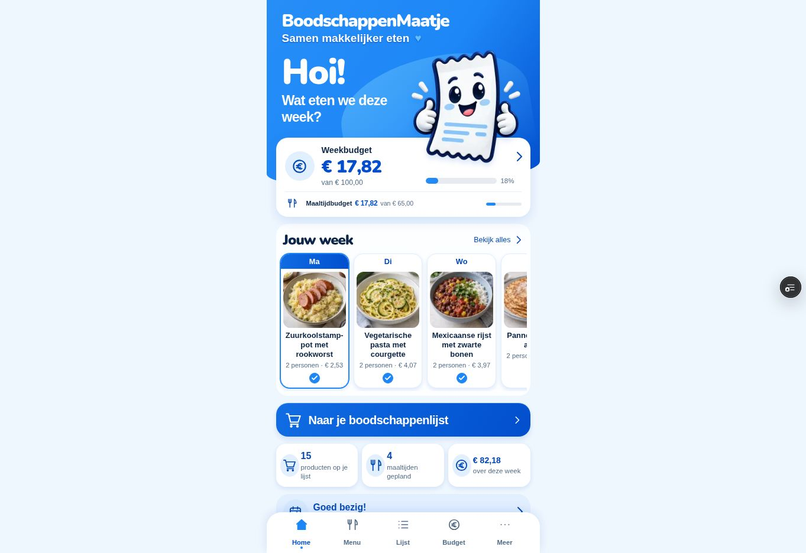
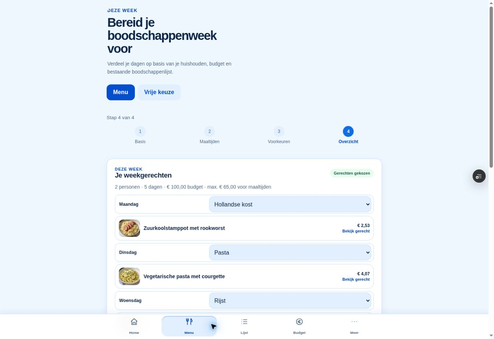
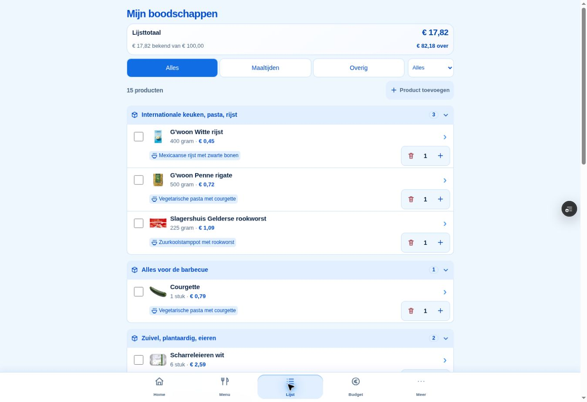
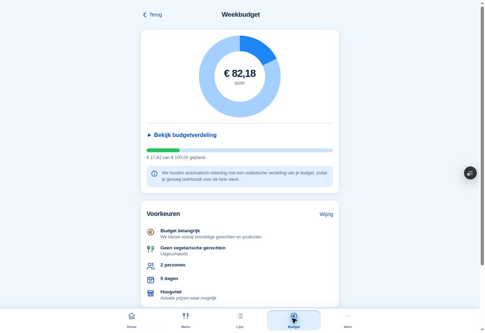
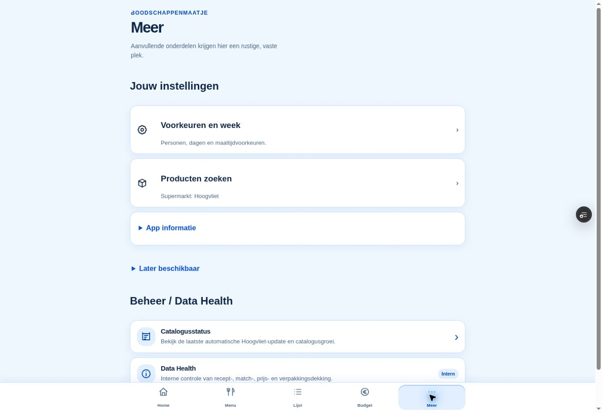

# Projectbrede blauwe huisstijl — fysieke hertest

Home is fysiek goedgekeurd. Deze uitbreiding houdt alle layouts en functies gelijk en vervangt de gedeelde metallic palette door de vijf originele icoonblauwtinten. DESIGN.md blijft pending tot goedkeuring.

Functionele commit: b5d983e082178514a9237d14be08e2c30dde9d09. Volledige CI: 36705723580 groen. Lokaal 791 webtests, lint, TypeScript en build groen.

[Preview](https://boodschappenmaatje-pwa-git-feature-ho-02f3d4-dennisverkaik-4661.vercel.app/)

| Rol | Kleur / afleiding |
| --- | --- |
| Primair | #1D87F7 |
| Lichter blauw | #278EF7 |
| Lichtaccent | #62BFFC |
| Diepblauw | #034ECD |
| Blauwe tekst | #0448B3 |
| Knopcontrast | #116DE4, primair/diep 55:45 |
| Lichtblauwe vlakken | primair gemengd met wit |

Bron: ongewijzigd origineel app-icoon, opnieuw gemeten op (1100,600), (1100,340), (620,100), (650,1190), (340,1080). Semantisch succesgroen, fout-/verwijderrood en waarschuwingen zijn behouden. Geen nieuwe layout of app-logica.

## Werkelijke browserbeelden

Desktopcloudbrowser, geen iOS-emulatie. De mobiele weergave kon niet door een ondersteunde browserfunctie worden ingesteld; een lokale testweergave werd door het URL-beleid geweigerd. Geen workaround gebruikt. Fysieke hertest blijft nodig. De bestaande responsive layout is niet gewijzigd.

Gerenderde kleuren gecontroleerd op Home, Menu, Lijst, Budget, Meer en Vrije keuze: geen oude metallic-kleurhits; zie blue-colour-audit.json in screenshots. Broncontrole vond evenmin oude merkhexen/RGBA-schaduwen. Dit is een gerichte palettecontrole, geen claim dat iedere mogelijke fout-/lege staat handmatig is doorlopen. Bestaande regressies bewaken die toestanden.

## iPhone-hertest

1. Herlaad de Preview in Safari en open alle vijf tabs: dezelfde heldere blauwe familie, leesbare tekst, oude indeling.
2. Open Menu en Vrije keuze; controleer stappen, selecties, gerechtkaarten en dagdetails.
3. Gebruik Lijstfilters en de bestaande +/−-bediening; controleer de gebruikelijke koppeling en bedragen.
4. Bekijk Budget en Meer, inclusief diagram, lichte vlakken, actieve navigatie en instellingen.
5. Groen blijft positieve status, rood blijft verwijderen/fout. Controleer safe areas en leesbaarheid op je iPhone.

Geen merge of Production-release vóór expliciete goedkeuring.
