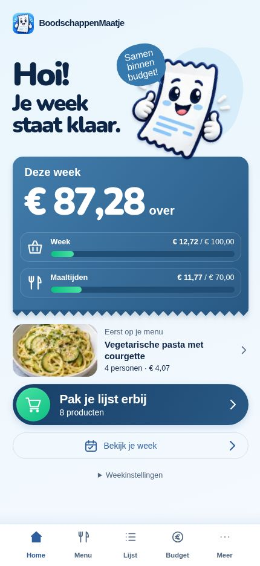
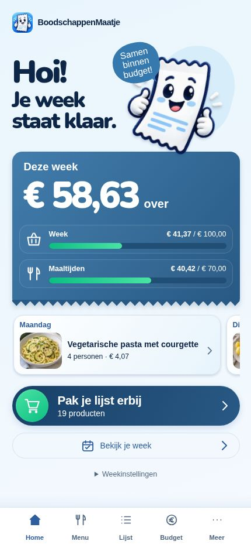

# Home Optie C — implementatie en acceptatie

## Bron en scope
Gebruikersreferentie `IMG_0326(2).jpeg`, uitsluitend rechter telefoon **C — Speels & persoonlijk**. Remote uitgangspunt `31705dd90c1f6d4b6d705b24219958f0c7894c84`. Draft PR #30 / `feature/home-option-c`. Geen merge of Production-actie.

## Vooraf geanalyseerde compositie
- Kleine merkregel bovenaan; zachtblauwe achtergrond en donker marineblauwe, zware afgeronde letters.
- Hero ongeveer 180px hoog op een smalle telefoonkolom: tekst links circa 58%, karakter rechts circa 42%; “Hoi!” duidelijk groter dan de twee regels eronder.
- Los wit 3D-bonnetje met donkere contour en duimpjes, lichte blauwe halo en afzonderlijk blauw tekstwolkje; onderzijde karakter steekt een klein stuk over de kaart.
- Budgetbon is visueel zwaartepunt: circa 230–250px hoog, blauwe diagonaalgradient, witte grote restwaarde, twee compacte transparante regels, groene balken en kartelrand.
- Kleine gerechtfoto links, compacte tekst en chevron rechts. Geen extra omlijnde grote gerechtkaart.
- Donkerblauwe pilvormige lijstactie, ronde groene winkelwagen, witte titel en producttelling. Dun omlijnde kalenderactie eronder.
- Rustige witte vijfdelige bottom navigation. Hoofdfuncties blijven de bestaande routes.

## Implementatie
`HomeDashboard` gebruikt dezelfde budget-, actieve-lijst- en weekproviders en ongewijzigde `calculateWeekBudgetSummary`, `calculateDishCostSummary` en `recipeImageFor`. Maaltijden gebruikt de bestaande generation-samenvatting; losse lijstbijdragen blijven alleen in het weektotaal. Geen nieuwe datafetch, state, API of opslagformaat.

`AppHeader` wordt zoals eerder uitsluitend op Home getoond. Lokale CSS en nieuwe `--home-c-*` tokens hebben geen invloed op andere schermen. Nunito 900 Latin is lokaal opgeslagen uit @fontsource/nunito 5.3.0 onder OFL, met licentie. De rest van de app houdt zijn bestaande fonts/tokens.

## Mascotte
- Bron: bestaand officieel `apps/web/public/icons/maatje-v1-512.png`.
- Bewerking via ingebouwde imagegen; achtergrondextractie met identiteit, gezicht en duimpjes behouden.
- Productieasset: `apps/web/public/branding/maatje-home-c.webp` (640×640, alpha, circa 55 kB), geoptimaliseerd met Sharp. Het officiële app-icoon is niet gewijzigd.
- Prompt: “Use case: background-extraction. Edit target: the attached official BoodschappenMaatje app icon. Produce a transparent PNG asset for a website hero. Remove ONLY the entire blue square and blue circular background. Keep the same friendly white 3D receipt mascot, its navy scalloped outline, smiling face, eyes, light blue cheeks and receipt lines, two white thumbs up and white expression rays. Preserve character identity and proportions precisely. Entire character visible, isolated, clean alpha transparency including gaps beside hands, modest transparent margin. No text, no speech bubble, no extra objects, no replacement character. Transparent background, not a checkerboard drawn into the image.”

## Bewuste verschillen met de referentie
- Echte bedragen, aantallen, gerecht en bijbehorende bestaande afbeelding; nooit de referentievoorbeelddata.
- Zonder volledige week: “Je week begint hier.”, passende lege maaltijd en “Maak mijn week”.
- Eerste checkpoint gebruikte “Eerst op je menu”. Dit is op fysieke feedback vervangen door de horizontale week-/gerechtslider; zie het actuele slidercheckpoint in PROJECT_STATE.md. Iedere opgeslagen dag blijft daarin zichtbaar, ook Vrije keuze en lege dagen.
- Bestaande weekinstellingen en Nieuwe week blijven in een compacte uitklapper bereikbaar. Bevestigingsflow ongewijzigd.
- Overschrijding heeft tekst en een amberkleurige balk; onbekende prijzen geven geen fictief restant.
- Geen exacte bronfont beschikbaar in rasterreferentie; lokale Nunito geeft de zware afgeronde lettervorm. Kartelrand is een robuuste CSS-benadering.

## Geautomatiseerde controle
Eerste volledige ronde: 745 webtests / 63 bestanden, kernset 248 / 14, lint, TypeScript en lokale Production-build groen. De 12 toegevoegde scenario's bewaken afzonderlijke budgetten/percentages, onbekende prijzen, overschrijding, eerste echte maaltijd, eigen-receptpersonen, lege week, lange naam, 1/2/4/10 personen, €1.000 en vijf navigatieroutes.

Bestaande echte provider-/UI-integratie uitgebreid: recept↔lijst plus onafhankelijke extra → Home toont €7,16 week, €5,37 maaltijden, €92,84 over en 2 producten; beide CTA's, cold reopen en annuleren Nieuwe week behouden de gemaakte keuzes.

Geen importerwijzigingen. De bestaande CI-releasegate voert verplicht zijn importerfixtures/seedchecks uit, zonder import of DB-actie.

## Preview en fysieke acceptatie
Preview: https://boodschappenmaatje-pwa-git-feature-ho-02f3d4-dennisverkaik-4661.vercel.app

Work-browser heeft geen telefoonviewport/resize-capability; gecontroleerd in een echte smalle Home-contentkolom van 390px binnen desktop. Dit is geen fysieke mobiele of Dynamic Type-acceptatie.

## Live eindbewijs — functionele head d30f304
- Preview en volledige CI-releasegate success. 745/745 webtests, 189/189 importerfixtures en seedchecks; lint, TypeScript en Production-build groen. Lokale kernset 248/248; laatste gerichte Home/UI/providerselectie 41/41.
- Schone Home toont geen fictieve week of gerecht; weekinstelling 4 personen / 3 dagen / €100 / €70 voltooid via bestaande UI.
- Drie echte maaltijden €11,77, 8 lijstproducten. Eerste gerecht Vegetarische pasta met courgette, 4 personen, €4,07. Bestaande passende receptafbeelding.
- Losse verpakking spinazie €0,95 toegevoegd via bestaande lijstherkomstactie: week €12,72, maaltijden €11,77, resterend €87,28. Beide balken afzonderlijk: 12,72% en 16,8143%. Na volledige reload behouden.
- Recept courgette 1→2: gerecht €4,86, week €13,51, maaltijden €12,56, resterend €86,49; Home toont alle wijzigingen. Lijstmin 2→1 herstelt de oorspronkelijke bedragen en laat de losse spinazie staan.
- Lijst-CTA, week-CTA, maaltijd→Menu, budgetkaart→Budget, vijf tabs en refresh/heropenen geslaagd. Andere schermen behouden hun ontwerp en gegevens.
- Budget tijdelijk €1.000 via bestaande Budget-UI: Home €987,28 over en afzonderlijke maaltijdgrens €70. Kaart, bedrag en budgetregels hadden geen interne horizontale overflow bij 390px contentbreedte. Daarna teruggezet op €100.
- Definitieve mascotte geladen met alpha. Pagina scrollWidth = clientWidth (1363px); Home gecontroleerd als echte 390px kolom, geen gesimuleerde iPhone. Gedraaid mascottevlak binnen de kolom, decoratieve halo blijft binnen schermpadding. De kaart, bedrag, maaltijd en CTA's passen zonder tekstoverlap.

**KLAAR VOOR FYSIEKE IPHONE-TEST — HOME OPTIE C.** Geen merge, Production, databasewijziging of productimport. DESIGN.md blijft ongewijzigd tot fysieke acceptatie.

Fysieke checklist: vergelijk hero/mascotte/budgetbon met C; controleer beide budgetten en maaltijd/producttelling; open beide CTA's en vijf tabs; wijzig één verpakking in recept en terug in lijst; heropen app; controleer smal scherm, grotere tekst, safe areas en scrollen. Weekinstellingen/Nieuwe week zitten onder de compacte uitklapper.

## Correctie op fysieke feedback — weekslider (PR #30)
De huidige Home bevat **één horizontale week-/gerechtslider** op de plaats van de oude enkele maaltijdregel. Geen losse dagchips en geen extra verticale sectie. Het bestaande dagmodel bepaalt kaartenaantal en volgorde; daglabels zijn gedeeld met Menu.

Functionele head `215586a5cf77a461626f8607c0a66c3a8b19dbd5`: 765 webtests / 64 bestanden, 254 kernsettests / 14 bestanden, lint, TypeScript, Production-build en volledige GitHub-releasegate groen. De nieuwe tests bewaken 1/3/5/7 dagen, alle kaartgegevens/foto's, afwijkende opgeslagen volgorde, Vrije keuze/lege dagen, exacte geopende Menu-dag met ingrediënten/−/+, routevalidatie, refresh en weekwijziging.

Echte Previewcontrole: zeven opgeslagen dagen → zeven kaarten. Woensdag opent Penne arrabbiata direct in Menu met drie ingrediënten (400g penne, 600g passata, 160g ui) en verpakkingsknoppen. Dit blijft na refresh correct open. Penne 1→2 gaf €2,91→€3,63 op Home; herkomstspecifieke lijstmin zette dit terug. Zondag opende de bestaande Vrije keuze-route voor dag 7; ingevulde Macaroni verschijnt vervolgens op de zondagkaart en opent Menu met vier ingrediënten. Eindstand 19 producten; €41,37 weekkosten, €40,42 maaltijdkosten en €58,63 over. Geen voorbeelddata gebruikt.

Native horizontale overflow/snap: 390px content, 2550px scrollbreedte voor zeven kaarten, sprong van 0 naar 365px via native bediening, geen horizontale overflow van het document. De volgende kaart is gedeeltelijk zichtbaar. Normale kaart circa 102px hoog; geen grote verticale uitbreiding.

Work heeft geen telefoonviewport-capability. Touch-scrollcommando's gaven browserprotocol-time-outs, dus daadwerkelijke aanraking is niet geverifieerd; toetsenbordscroll, focus, snap en kaartnavigatie wel. Controleer fysiek op iPhone links/rechts swipen, snap, grotere tekst, safe areas, 1/3/5/7 dagen, dag 3 openen, Vrije keuze/lege dag, beide CTA's en heropenen.

